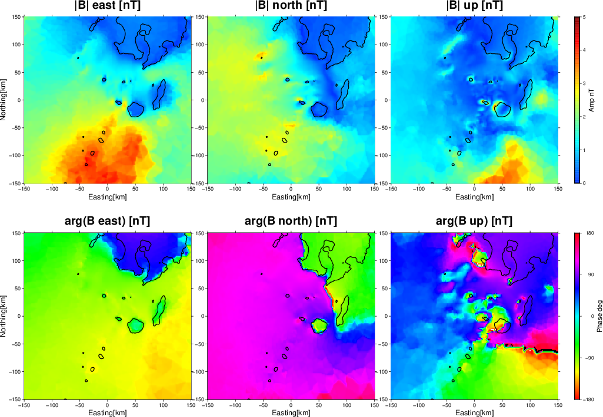
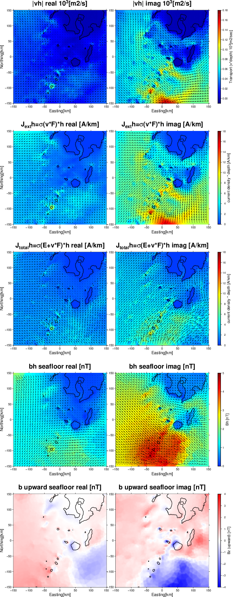

# Manual of ActFEMtide
## Finite element simulation code for tide-induced electromagnetic field

#### As of July 23, 2026

Takuto MINAMI
tminami@port.kobe-u.ac.jp
(Graduate School of Science, Kobe University)

### Contents

1. [Introduction](#Introduction)
2. [Important notes](#ImportantNotes)
3. [Required environments](#Required_environments)
4. [Run sample simulations](#Run_sample_simulations)  
 - Sample 1: [Kikai](#Tohoku_small)
5. [Inversion tutorial](#Inversion_tutorial)
   - [5.1 Step 1: Preparation](#sec5_1)
   - [5.2 Step 2: Synthetic tide-induced magnetic data](#sec5_2)
   - [5.3 Step 3: Synthetic MT data](#sec5_3)
   - [5.4 Step 4: Run the inversion](#sec5_4)
   - [5.5 Step 5: Check the results](#sec5_5)
6. [Inversion control file (joint.ctl)](#Inversion_control)
   - [6.1 General rules](#sec6_1)
   - [6.2 List of items](#sec6_2)
   - [6.3 Example](#sec6_3)
   - [6.4 Data file formats](#sec6_4)

[References](#References)

## 0 Get ActFEMtide
Please download ActFEMtide via github. If you don't have ssh access to github, type 
####
    $git clone https://github.com/takuto0126/ActFEMtide

If you have ssh access to github,
####
    $git clone git@github.com:takuto0126/ActFEMtide.git 

Pull Request to ActFEMtide main branch is always welcome!

## 1 Introduction 
__ActFEMtide__ is a simulation code for calculating tide-generated electromagnetic fields via electromotive force in the ocean. The main solver is based on __ActFEM__ [(Minami et al. 2018)](#Minami2018) with the replacement of the source term of electric dipole source by tidally-induced electromotive force ($\mathbf{v}\times \mathbf{F}$).
__ActFEMtide__ is written in fortran and uses intel-math-kernel library (mkl) for the use of a sparse direct solver, PARDISO. ActFEMtide can use openMP for parallel computation with PARDISO, and MPI for parallel computation for multiple frequencies.
__ActFEMtide__ uses the meshgenerator developed for __TMTGEM__ [(MInami et al. 2017)](#Minami2017).
ActFEMtide is composed of two parts: 1: Mesh generation part, 2: Simulation part. __ActFEMtide__ is currently assume to use the output of tide model by [(Egbert and Erofeeva, 2002)](#EE2002).
__ActFEMtide__ uses [Gmsh](https://www.soest.hawaii.edu/gmt/) for mesh generation and the extrude algorithm described in [Oishi et al. (2013)](#O2013), which was originally developed for __TMTGEM__. Most of the subroutines for extrusion are from a fluid simulation open-source code, [Fluidity](http://fluidityproject.github.io/).

Note that there are many copied contents from __TMTGEM__ manual (v1.3).

## 2 Important notes 
Coordinate system: X: eastward, Y: northward, Z: upward

__Solved equations:__ Refer to [Minami et al. (2018, EPS)](#Minami2018) (with modification to $\mathbf{v}\times \mathbf{F}$ source). For readers new to the finite element method (especially edge-element FEM for electromagnetics), [Honma, Igarashi & Kawaguchi (2002)](#Honma2002) (in Japanese) is recommended as an accessible introduction.

__Input topography data:__ lon [deg], lat [deg], alt [m, __Downward Positive__]

__Assumed tide model:__ [Egbert and Erofeeva (2002)](#EE2002)

## 3 Required environment 
Please make the following packages installed in your PC:

- __Gmsh__ [(http://gmsh.info/)](http://gmsh.info/) for mesh generation

- __Intel fortran compiler with mkl library__ (confirm you can use “ifort –mkl=parallel ***”)

- __GMT__ ([generic mapping tool](https://www.soest.hawaii.edu/gmt/)) for vieweing simulation results
ghostscript (only for “gv” commands, e.g. in plot_z.sh in TMTGEM/Tohoku/flow)

If you can use Debian Linux distributions, "sudo apt install ***" help you install all the environments above.

## 4 Run sample codes in "Kikai/" 
Run ActFEMtide anyway!! 
In the home folder of ActFEMtide/, the folder named Kikai/ is that for example simulations.
To run the sample codes there are run by several steps.

### Step0 Preparation of tide model (ActFEMtide/mkfvxyz/)
Compile the code [(Egbert and Erofeeva, 2002)](#EE2002) in ActFEMtide/mkfvxyz/
####  
    $cd mkfvxyz
    $cd OTPS
    $make           (compile the codes for use of tide model)

If you are working in triton, copy data by the folloiwng command in ActFEMtide/mkfvxyz/OTPS/
####
    $cd DATA
    $./wget.sh    (get tide models in ActFEMtide/mkfvxyz/OTPS/DATA/)
Please confirm that the following files are prepared in ActFEMtide/mkfvxyz/OTPS/DATA/TPXO9_atlas_v3_test/:

grid_tpxo9_atlas_30_v3,   h_q1_tpxo9_atlas_30_v3,
h_2n2_tpxo9_atlas_30_v3,  h_s2_tpxo9_atlas_30_v3,
h_k2_tpxo9_atlas_30_v3,   u_k1_tpxo9_atlas_30_v3,
h_mf_tpxo9_atlas_30_v3,   u_m2_tpxo9_atlas_30_v3,
h_mm_tpxo9_atlas_30_v3,   u_m4_tpxo9_atlas_30_v3,
h_mn4_tpxo9_atlas_30_v3,  u_mm_tpxo9_atlas_30_v3,
h_ms4_tpxo9_atlas_30_v3,  u_mn4_tpxo9_atlas_30_v3,
h_n2_tpxo9_atlas_30_v3,   u_n2_tpxo9_atlas_30_v3,
h_o1_tpxo9_atlas_30_v3,   u_p1_tpxo9_atlas_30_v3,
h_p1_tpxo9_atlas_30_v3,   u_s2_tpxo9_atlas_30_v3

### Step 1: Preparation of topo (ActFEMtide/Kikai/topo/)
#### convert etopo grd file to ascii *.xyz file. 
    $cd Kikai/topo
    $./mk_etopo_kikai.sh        (etopo_kikai-l.xyz is generated)

### Step 2: Generation of tetrahedral mesh (ActFEMtide/Kikai/mesh/)
#### Generation of tetrahedral mesh 
    $cd ../mesh
    $./tetmeshgen.sh             (em3d.msh and others are generated)
It takes a while dependent on the spec of your PC. Many files are generated but the key three dimensional tetrahedral mesh file is "em3d.msh". Please download the mesh file to local, and check it by folloing the next step.

### Step 3: Check the generated mesh files (ActFEMtide/Kikai/mesh/)
#### After downloading the contents in ActFEM/Kikai/mesh
    $gmsh em3d.msh

If you generate the mesh successfully, you can see the mesh after downloading em3d.msh to local PC.

### Step 4: Prepare resistivity model (ActFEMtide/Kikai/structure/)
#### Based on the generated mesh, resisitivity model is created.
    $cd ../structure/
    $./change_model2cond.sh
Please check the change_cond.ctl for the parameters.

### Step 5: Preapre tidal flow and background magnetic field (ActFEMtide/Kikai/fvxyz/)
####
    $cd ../fvxyz
    $./mkfvxyz_mesh.sh

### Step 6: run ActFEMtide (ActFEMtide/Kikai/fwd_tide/)
####
    $cd ../fwd_tide
    $./run_fwd.sh
See result/ folder for output files.

### Step 7: check the results (ActFEMtide/Kikai/fwd_tide/)
    $./plot_bxyz.sh
    $./plot_ixyh.sh
You can generate two pdf files below.

Figure 1. Tidally-induced magnetic fields due to M2 tide. All the three components are the values at the seafloor. The figure is generated by plot_bxyz.sh.

Figure 2. Real and Imaginary values of magnetic and electric fields due to M2 tide. The gifure is generated by plot_ixyh.sh.

## 5 Inversion tutorial 
The inversion code of ActFEMtide (src/src_inv_joint/ebfem_inv_joint.exe) estimates the resistivity structure from tide-induced electromagnetic data, MT data, or both. Three samples are provided in Kikai/.

| Folder | Data used | ijoint | Files given on standard input (in order) | MPI processes |
|:--|:--|:--:|:--|:--:|
| Kikai/inv_tide/ | Tide-induced magnetic field only | 1 | tide_fwd.ctl, joint.ctl | 1 |
| Kikai/inv_mt/ | MT impedance only | 2 | mt.ctl, joint.ctl | 6 |
| Kikai/inv_joint/ | Tide-induced magnetic field + MT impedance | 3 | tide_fwd.ctl, mt.ctl, joint.ctl | 6 |

- The program first reads ijoint (1: tide only, 2: MT only, 3: both), then the paths of the forward control file(s) and of the inversion control file (joint.ctl, [Section 6](#Inversion_control)).
- tide_fwd.ctl has the same format as the control file of the tidal forward simulation (Step 6 in Section 4) and specifies the mesh, sites, frequency, etc. mt.ctl is the control file of the MT forward simulation. The resistivity models for the inversion (initial and reference models) are given in joint.ctl.
- MPI is used to parallelize over frequencies. Use at most as many processes as the total number of frequencies (1 tidal + 5 MT frequencies in the samples).

In the samples, synthetic data calculated for the true structure (cond_test.msh) are inverted, starting from a homogeneous structure (cond_homo.msh).

### 5.1 Step 1: Preparation (mesh, resistivity structure, tidal flow) 
Finish Steps 1-5 in Section 4. The inversion uses the following files.

- Mesh files in Kikai/mesh/ (em3d.msh, polygonz.msh, lineinfo.dat, ocean.msh, etc.)
- cond_homo.msh (homogeneous 100 Ohm-m; initial and reference model) and cond_test.msh (true structure) in Kikai/structure/
- vxyz_mesh and fxyz_mesh (tidal velocity and background magnetic field) in Kikai/fvxyz/

### 5.2 Step 2: Synthetic tide-induced magnetic data (Kikai/fwd_tide/) 
    $cd Kikai/fwd_tide
    $./run_fwd.sh           (forward calculation for cond_test.msh; result/P5_S1.dat etc. are generated)
    $./generr_tide.sh       (data_inv/P5_tide_amp.dat, P5_tide_pha.dat etc. are generated)

generr_tide.sh adds errors (10% of the amplitude, set by "ratio") to the calculated amplitudes and phases, and writes the data files for the inversion. See [Section 6.4](#sec6_4) for the file format.

### 5.3 Step 3: Synthetic MT data (Kikai/fwd_mt/) 
This step is needed for inv_mt and inv_joint.

    $cd ../fwd_mt
    $./run_mt.sh            (result/P5_MT_imp.dat etc. are generated)
    $./generr_imp.sh        (data_inv/P5_MT_imp_err.dat etc. are generated)
    $./generr_tip.sh        (only when tippers are used; data_inv/P5_MT_tip_err.dat etc. are generated)

The sample joint.ctl reads the forward results (../fwd_mt/result/P*_MT_imp.dat) as impedance data and data_inv/P*_MT_imp_err.dat as their errors.

### 5.4 Step 4: Run the inversion 
Tide data only (ijoint = 1):

    $cd ../inv_tide
    $./run_inv.sh

MT data only (ijoint = 2):

    $cd ../inv_mt
    $./run_inv.sh

Tide + MT data (ijoint = 3):

    $cd ../inv_joint
    $./run_inv.sh

run_inv.sh compiles src/src_inv_joint/, empties result_inv/ with clean.sh, and runs the inversion. For example, inv_joint/run_inv.sh gives the following input to the program.

    mpiexec -n 6 ${src}/ebfem_inv_joint.exe <<EOF | tee result_inv/inv.log
    3
    tide_fwd.ctl
    mt.ctl
    joint.ctl
    EOF

In inv_mt/joint.ctl, the tide-data items are commented out with "##". inv_tide/joint.ctl (ijoint = 1) contains no MT-data items ([Section 6.1](#sec6_1)).

The iteration stops when the normalized RMS of all data falls below "final rms", or after 20 iterations (fixed in the source).

### 5.5 Step 5: Check the results 
The results are written to result_inv/.

| File | Content |
|:--|:--|
| inv.log | Log of the run |
| rms.dat | Normalized RMS, RMS, regularization parameter alpha, and roughness of the tide data at each iteration (ijoint = 1, 3) |
| rms_mt.dat | Normalized RMS etc. of the MT data at each iteration (ijoint = 2, 3) |
| model_connect.dat | Correspondence between model blocks and tetrahedral elements |
| modelNN.dat | Resistivity model at iteration NN |
| P5_S1_BxampNN.dat, P5_S1_BxphaNN.dat, etc. | Calculated tide-induced magnetic field at iteration NN. NN = IN is the observed data |
| P5_MT_impNN.dat, P5_MTNN.dat, etc. | Calculated MT impedance and apparent resistivity/phase at iteration NN. NN = IN is the observed data |
| site_act.dat, S1_site.dat, site_mt.dat | Site locations (for plotting) |

Plot the RMS history and slices of the resistivity structure as follows.

    $./plot_rms.sh          (rms.pdf is generated)
    $./view_slice.sh 10     (slices of the model at iteration 10, model10.dat)

The location and range of the slices can be changed with z_elevation, y_slice, x_slice, etc. at the top of view_slice.sh. Note that plot_fit_MT.sh, plot_fit_active.sh, and plot_rho_pha.sh are inherited from ActFEM and do not support the site names of Kikai.

## 6 Inversion control file (joint.ctl) 
### 6.1 General rules 
- Lines starting with "##" are comments and are skipped. Lines starting with a single "#" (e.g., "# of srces for inv") are NOT comments.
- Columns 1-20 of each line are a label, which the program does not read. Values are written from column 21. The "!" or "|" at column 20 is only a visual separator.
- Items are read in a fixed order. Do not add, delete, or reorder lines. To disable an item, comment out the line with "##".
- The part that is read depends on ijoint. The tide-data part (B in [Section 6.2](#sec6_2)) is read only for ijoint = 1 or 3, and the MT-data part (C) only for ijoint = 2 or 3. Delete the part that is not read, or comment it out with "##".
- Coordinates of the model partition (D) are written from column 1 without labels.

### 6.2 List of items 
**A. Common (model and regularization)**

| Item (label) | Description |
|:--|:--|
| face info file | Path to a face information file. Currently not used, but the line is required. |
| 1:cond,2:model (1st) | How the reference model is given (icondflag_ref). 0: homogeneous (conductivity [S/m] on the next line), 1: resistivity file cond.msh (path on the next line), 2: model_connect file and model file (paths on the next two lines). |
| ref cond file | Reference model file (when icondflag_ref = 1). |
| 1:cond,2:model (2nd) | How the initial model is given (icondflag_ini). Same options as the reference model. |
| init cond file | Initial model file (when icondflag_ini = 1). |
| output folder | Output folder of the results (e.g., ./result_inv/). |
| Roughness type | Type of model constraint. 1: smoothest, 2: minimum support, 3: minimum support gradient, 4: minimum gradient support. For 2 or larger, write beta on the next line. |
| 1:L,2:Cl,3:Mi,4:Gr | How the regularization parameter alpha is chosen (ialphaflag). 1: L-curve, 2: cooling from a given initial value, 3: cooling with the initial value from spectral radii (Minami et al.), 4: modified version of Grayver et al. (2013). |
| alpha init | Initial alpha when ialphaflag = 2. |
| factor(10^factor) | When ialphaflag = 2, alpha is reduced to alpha × 10^factor at each iteration (factor < 0). |
| iflag_replace 0,1 | When ialphaflag = 2, 1 replaces the reference model with the previous model if the normalized RMS increases. |
| iboundflag | Bounds of resistivity. 0: none, 1: cut at the bounds (upper and lower log10 resistivity on the next two lines), 2: transformed variable that automatically satisfies the bounds (Grayver et al., 2013; p, upper, lower, and BMIdenomflag on the following lines). 0 is recommended for the smoothness constraint. |

For ialphaflag = 1, write the number of alpha values and the alpha values (one per line) instead of the two lines "alpha init" and "factor". For ialphaflag = 3 or 4, write one line with the parameter gamma instead of the three lines from "alpha init".

**B. Tide data (ijoint = 1, 3)**

| Item (label) | Description |
|:--|:--|
| # of srces for inv | Number of sources used for the inversion. 1 for tides. |
| Bx,By,Bz,Ex,Ey(5i2) | Whether each component is used (1) or not (0). Write five 2-digit integers from column 21. The samples use the three magnetic components only. |
| Act err floor [0-1] | Error floor. The relative error of amplitude is not allowed below this value, and the phase error not below asin(this value) [deg]. |
| index of source(S1) | Index of the source in tide_fwd.ctl (the following items are repeated for each source). |
| # of obesrvatories | Number of sites used for this source. Must not exceed the number of sites in tide_fwd.ctl. |
| P5 amp data, etc. | Amplitude data. From column 21, write the site index in tide_fwd.ctl and the path of the data file. One line per site. |
| P5 pha data, etc. | Phase data. Same format as amplitude, one line per site. |

**C. MT data (ijoint = 2, 3)**

| Item (label) | Description |
|:--|:--|
| imp: 0, 1:amp,pha | How impedances are used (mt_imp_ap_flag). -1: no impedance (tipper only), 0: impedance as it is, 1: converted to apparent resistivity and phase. |
| unit:1Ohm,2mV/km/nT | Unit of the impedance data. 1: Ohm, 2: mV/km/nT (omit when mt_imp_ap_flag = -1). |
| MT errfloor SSQ* | Error floor. The error is not allowed below this value times $\left|\sqrt{(Z_{xx}^2+Z_{xy}^2+Z_{yx}^2+Z_{yy}^2)/2}\right|$ (omit when mt_imp_ap_flag = -1). |
| # of observatories | Number of MT sites. |
| P5 impedance, etc. | Impedance data. From column 21, write the site index and the file path, one line per site (omit when mt_imp_ap_flag = -1). |
| P5 impedance err, etc. | Impedance error files, same format, one line per site (omit when mt_imp_ap_flag = -1). |
| iflag_tipper | Whether tippers are used (1) or not (0). For 1, write the tipper error floor on the next line, followed by one line "site index, file path" per site. |

**D. Model partition and output**

| Item (label) | Description |
|:--|:--|
| icombine:0,1,2:fix | How model blocks are made. 0: use the partitioned cuboids as they are, 1: merge the outer blocks into one and estimate it, 2: merge the outer blocks into one and fix it to the initial model, -1: inner/outer mode. |
| (no label) | Number of boundaries in x, nx, followed by nx lines of x coordinates [km], one per line. Then y and z (elevation [km], upward positive, sea level = 0) in the same way. |
| ioutlevel:0,1:Jacob | 1 outputs the Jacobian matrix (when tide data are used). |
| final rms | Normalized RMS for convergence. The inversion stops when the normalized RMS of all data falls below this value (values smaller than 0.1 are replaced by 1.0). |

x and y are distances from the origin (lonlatorigin) of tide_fwd.ctl (or mt.ctl), positive eastward and northward. Model blocks are made for the land and sub-seafloor elements contained in the resistivity file (cond.msh); the conductivities of air and ocean are fixed. For icombine = -1, after the z coordinates, write the start, end, and increment of x of the inner region, the same for y (one value per line), and the number of inner z boundaries followed by their z coordinates.

### 6.3 Example (part of Kikai/inv_joint/joint.ctl) 
    ##-----10!-------20!
    face info file     !../../mesh_joint/faceinfo.dat
    1:cond,2:model     !1
    ref  cond file     !../structure/cond_homo.msh
    1:cond,2:model     !1
    init cond file     !../structure/cond_homo.msh
    output folder      |./result_inv/
    Roughness type     |1
    1:L,2:Cl,3:Mi,4:Gr !2
    alpha init         !100.
    factor(10^factor)  !-0.25
    iflag_replace 0,1  |0
     iboundflag =      !0
    ## ACTIVE data ##########################################
    # of srces for inv !1
    Bx,By,Bz,Ex,Ey(5i2)!1 1 1 0 0
    Act err floor [0-1]!0.03
    index of source(S1)!1
    # of obesrvatories !14
    P5  amp data       !   1 ../fwd_tide/data_inv/P5_tide_amp.dat
    (snip: amplitudes of P6-P18, phases of P5-P18)
    ## MT data ##############################################
    imp: 0, 1:amp,pha  !0
    unit:1Ohm,2mV/km/nT!2
    MT errfloor SSQ*   !0.1
    # of observatories |14
    P5  impedance      !   1 ../fwd_mt/result/P5_MT_imp.dat
    (snip: impedances of P6-P18, error files of P5-P18)
    iflag_tipper       !0
    icombine:0,1,2:fix !1
    27
    -250.0
    (snip: 27 x coordinates; y in the same way)
    27
    -350.0
    (snip: 27 z coordinates)
    0.0
    ioutlevel:0,1:Jacob|0
    final rms          |1.0

### 6.4 Data file formats 
In all files, one line corresponds to one frequency.

**Tide data (amplitude file *_amp.dat, phase file *_pha.dat)**

    freq[Hz]  iflag(Bx By Bz Ex Ey)  value(Bx By Bz Ex Ey)  error(Bx By Bz Ex Ey)

iflag is 1 if the data of the component exist and 0 otherwise. Amplitudes are in nT and phases in degrees. These files can be made with generr_tide.sh.

**MT impedance (*_MT_imp.dat) and errors (*_MT_imp_err.dat)**

    freq[Hz]  ReZxx ImZxx ReZxy ImZxy ReZyx ImZyx ReZyy ImZyy
    freq[Hz]  iflag(Zxx Zxy Zyx Zyy)  error(the same 8 values)

**Tipper (*_MT_tip_err.dat)**

    freq[Hz]  iflag(Tx Ty)  ReTx ImTx ReTy ImTy  error(4 values)

Tipper data and errors are written in one file, which can be made with generr_tip.sh.

## References 
- Egbert, G. D., & Erofeeva, S. Y. (2002). Efficient inverse modeling of barotropic ocean tides. Journal of Atmospheric and Oceanic technology, 19(2), 183-204.
- Minami, T., Utsugi, M., Utada, H., Kagiyama, T., & Inoue, H. (2018). Temporal variation in the resistivity structure of the first Nakadake crater, Aso volcano, Japan, during the magmatic eruptions from November 2014 to May 2015, as inferred by the ACTIVE electromagnetic monitoring system. Earth, Planets and Space, 70(1), 138. 
- Minami, T., Toh, H., Ichihara, H., & Kawashima, I. (2017). Three‐Dimensional Time Domain Simulation of Tsunami‐Generated Electromagnetic Fields: Application to the 2011 Tohoku Earthquake Tsunami. Journal of Geophysical Research: Solid Earth, 122(12), 9559-9579. 
- Honma, T., Igarashi, H., & Kawaguchi, H. (2002). Suuchi Denjirikigaku: Kiso to Ouyou [Numerical Electromagnetics: Fundamentals and Applications] (Japan Society for Simulation Technology, Ed.). Morikita Publishing, 251 pp. (in Japanese). ISBN 4-627-71641-9 (2021 edition: ISBN 978-4-627-71649-0). https://www.morikita.co.jp/books/mid/071641 

