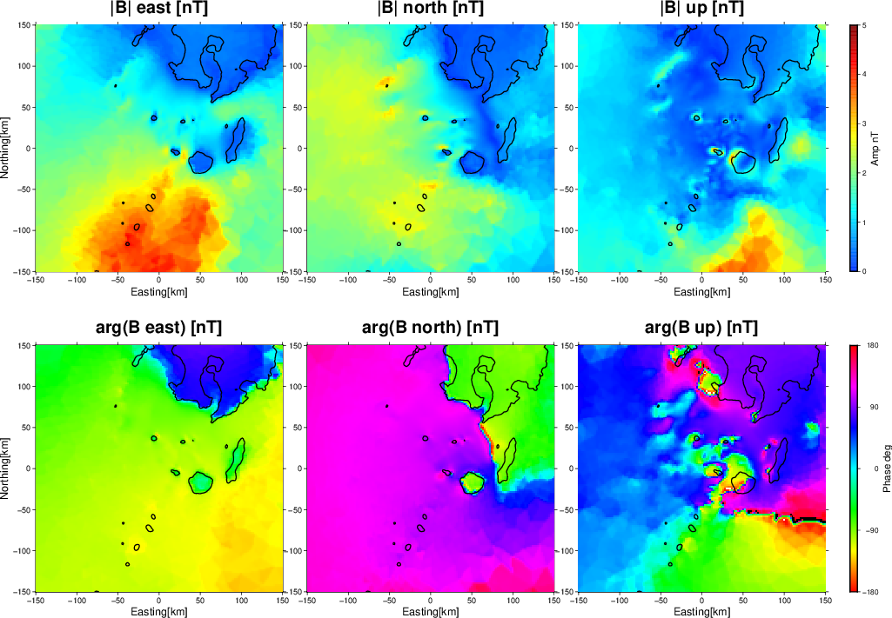
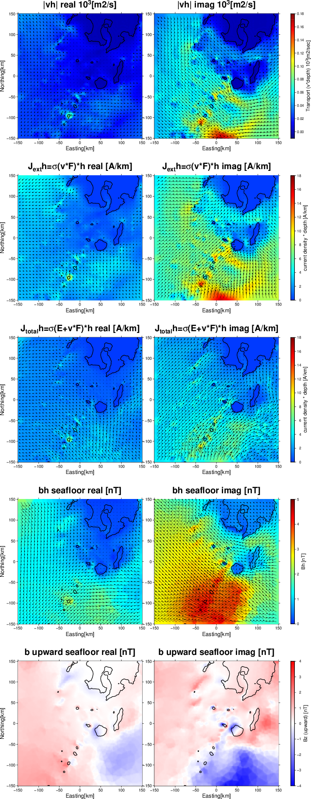
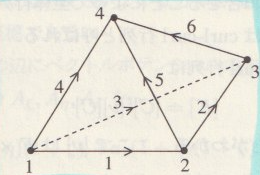

# ActFEMtide マニュアル
## 潮汐起源電磁場のための有限要素法シミュレーションコード

#### 2026年7月23日現在

南 拓人
tminami@port.kobe-u.ac.jp
（神戸大学大学院理学研究科）

### 目次

1. [はじめに](#Introduction)
2. [重要事項](#ImportantNotes)
3. [必要な環境](#Required_environments)
4. [サンプルシミュレーションの実行](#Run_sample_simulations)  
 - サンプル1: [鬼海カルデラ (Kikai)](#Tohoku_small)
5. [支配方程式と離散化](#Governing_equation_and_discretization)
   - [5.1 支配方程式](#sec5_1)
   - [5.2 弱形式](#sec5_2)
   - [5.3 辺要素による離散化](#sec5_3)
   - [5.4 潮汐起電力項（右辺ベクトル）](#sec5_4)
   - [5.5 スケーリングと単位](#sec5_5)
   - [5.6 電場・磁場・電流の計算](#sec5_6)
6. [インバージョンのチュートリアル](#Inversion_tutorial)
   - [6.1 Step 1: 準備](#sec6_1)
   - [6.2 Step 2: 潮汐起源磁場の合成データの作成](#sec6_2)
   - [6.3 Step 3: MT の合成データの作成](#sec6_3)
   - [6.4 Step 4: インバージョンの実行](#sec6_4)
   - [6.5 Step 5: 結果の確認](#sec6_5)
7. [インバージョン制御ファイル（joint.ctl）](#Inversion_control)
   - [7.1 共通の規則](#sec7_1)
   - [7.2 項目一覧](#sec7_2)
   - [7.3 例](#sec7_3)
   - [7.4 データファイルの形式](#sec7_4)

## 1 はじめに 
__ActFEMtide__ は、海洋中の起電力を介して潮汐起源の電磁場を計算するためのシミュレーションコードである。メインのソルバーは __ActFEM__ [(Minami et al. 2018)](#Minami2018) をベースとしており、励起源を電流ダイポールから潮汐起源の起電力（$\mathbf{v}\times \mathbf{F}$）に置き換えたものである。
__ActFEMtide__ は Fortran で書かれており、疎行列直接解法ソルバー PARDISO を使用するために Intel Math Kernel Library (mkl) を利用する。ActFEMtide は PARDISO による並列計算に openMP を、複数周波数に対する並列計算に MPI を使用できる。
__ActFEMtide__ は __TMTGEM__ [(Minami et al. 2017)](#Minami2017) のために開発されたメッシュ生成部を使用している。
ActFEMtide は 1: メッシュ生成部、2: シミュレーション部の2つの部分から構成される。__ActFEMtide__ は現在、[(Egbert and Erofeeva, 2002)](#EE2002) による潮汐モデルの出力を使用することを前提としている。
__ActFEMtide__ はメッシュ生成に [Gmsh](https://www.soest.hawaii.edu/gmt/) を使用し、[Oishi et al. (2013)](#O2013) に記載された extrude アルゴリズムを用いる。これはもともと __TMTGEM__ のために開発されたものである。extrusion のためのサブルーチンの多くは、流体シミュレーションのオープンソースコードである [Fluidity](http://fluidityproject.github.io/) に由来する。

なお、本マニュアルには __TMTGEM__ マニュアル（v1.3）からの流用箇所が多く含まれることに注意されたい。

## 2 重要事項 
座標系: X: 東向き, Y: 北向き, Z: 上向き

__支配方程式:__ [5 支配方程式と離散化](#Governing_equation_and_discretization) を参照（[Minami et al. (2018, EPS)](#Minami2018) の送信源項を起電力項 $\sigma\,\mathbf{v}\times \mathbf{F}$ に変更）

__入力する地形データ:__ 経度 [deg], 緯度 [deg], 高度 [m, __下向き正__]

__使用する潮汐モデル:__ [Egbert and Erofeeva (2002)](#EE2002)

## 3 必要な環境 
以下のパッケージをPCにインストールしておくこと:

- __Gmsh__ [(http://gmsh.info/)](http://gmsh.info/) （メッシュ生成用）

- __mkl ライブラリ付きの Intel fortran コンパイラ__ （“ifort –mkl=parallel ***” が使用できることを確認すること）

- __GMT__ ([generic mapping tool](https://www.soest.hawaii.edu/gmt/)) （シミュレーション結果の可視化用）
ghostscript （TMTGEM/Tohoku/flow 内の plot_z.sh などで使用する “gv” コマンドのみに必要）

Debian 系の Linux ディストリビューションが使用できる場合、"sudo apt install ***" によって上記の環境をすべてインストールできる。

## 4 "Kikai/" 内のサンプルコードの実行 
とにかく ActFEMtide を実行してみよう！！
ActFEMtide のホームフォルダ内に、サンプルシミュレーション用の Kikai/ フォルダがある。
そこにあるサンプルコードは、以下のいくつかのステップで実行される。

### Step0 潮汐モデルの準備
[(Egbert and Erofeeva, 2002)](#EE2002) のコードを ActFEMtide/mkfvxyz/ 内でコンパイルする
####  
    $cd mkfvxyz
    $cd OTPS
    $make           (潮汐モデルを使用するためのコードをコンパイルする)

triton で作業している場合は、ActFEMtide/mkfvxyz/OTPS/ 内で以下のコマンドによりデータをコピーする
####
    $./wget.sh
DATA フォルダ内に、以下のファイルが準備されていることを確認すること:

### Step 1: 「地形データの準備」(ActFEMtide/Kikai/topo/)
#### etopo の grd ファイルを ascii 形式の *.xyz ファイルに変換する
    $cd Kikai/topo
    $./mk_etopo_kikai.sh        (etopo_kikai-l.xyz が生成される)

### Step 2: 四面体メッシュの生成 (ActFEMtide/Kikai/mesh/)
#### 四面体メッシュの生成
    $cd ../mesh
    $./tetmeshgen.sh             (em3d.msh 等が生成される)
使用しているPCのスペックによっては、これにはしばらく時間がかかる。多くのファイルが生成されるが、鍵となる三次元四面体メッシュファイルは "em3d.msh" である。メッシュファイルをローカルにダウンロードし、以下のステップで確認すること。

### Step 3: 生成されたメッシュファイルの確認
#### ActFEM/Kikai/mesh 内のファイルをダウンロードした後
    $gmsh em3d.msh

メッシュの生成に成功していれば、メッシュを見ることができる。

### Step 4: 比抵抗構造の作成 (ActFEMtide/Kikai/structure/)
#### 生成したメッシュをもとに比抵抗構造を作成する
    $cd ../structure
    $./change_model2cond.sh     (cond_homo.msh と cond_test.msh が生成される)
パラメータは change_model2cond.sh の中の制御ファイル部分を参照すること。

### Step 5: 潮汐流と背景磁場の準備 (ActFEMtide/Kikai/fvxyz/)
####
    $cd ../fvxyz
    $./mkfvxyz_mesh.sh

### Step 6: ActFEMtide の実行 (ActFEMtide/Kikai/fwd_tide/)
####
    $cd ../fwd_tide
    $./run_fwd.sh

### Step 7: 結果の確認 (ActFEMtide/Kikai/fwd_tide/)
    $./plot_bxyz.sh
    $./plot_ixyh.sh
以下の2つの図が生成される。

図1. M2潮汐による潮汐起源磁場。3成分すべて海底における値である。この図は plot_bxyz.sh により生成される。

図2. M2潮汐による磁場・電場の実部および虚部。この図は plot_ixyh.sh により生成される。

## 5 支配方程式と離散化 
ActFEMtide のソルバーは __ActFEM__ [(Minami et al. 2018)](#Minami2018) と同じく、ベクトルポテンシャル $\mathbf{A}$ に関する誘導方程式を、四面体メッシュ上の辺要素（Nédélec 一次要素）有限要素法で周波数領域において解く。ActFEM との違いは右辺の励起源のみであり、ActFEM の送信源電流 $\mathbf{i}_s$ の代わりに、海水の運動により生じる起電力 $\sigma\,\mathbf{v}\times\mathbf{F}$ を与える。以下、離散化の導出は ActFEM マニュアル（v1.5、付録A・B）に従う。有限要素法（特に辺要素を用いた電磁場解析）を初めて学ぶ読者には、[本間・五十嵐・川口 (2002)『数値電磁力学：基礎と応用』](#Honma2002) が分かりやすい入門書として薦められる。

### 5.1 支配方程式 
導電率 $\sigma$ の海水が、背景磁場（地球主磁場）$\mathbf{F}$ の中を速度 $\mathbf{v}$ で運動するとき、オームの法則は

$$\mathbf{j} = \sigma\left( \mathbf{E} + \mathbf{v}\times\mathbf{F} \right)$$

となる。変位電流を無視したアンペールの法則 $\nabla\times\mathbf{B} = \mu\mathbf{j}$ に $\mathbf{B} = \nabla\times\mathbf{A}$ を代入し、ActFEM と同じ規約 $\mathbf{E} = i\omega\mathbf{A}$ で電場を表すと、ActFEMtide が解く支配方程式

$$\nabla\times\left( \nabla\times\mathbf{A} \right) + i\omega\mu\sigma\mathbf{A} = \mu\sigma\left( \mathbf{v}\times\mathbf{F} \right) \cdot \cdot \cdot (5.1)$$

が得られる。ここで $\omega$ は潮汐分潮の角周波数、$\mu$ は透磁率（真空の透磁率 $\mu_0$ を使用）である。ActFEM の式 $\nabla\times\nabla\times\mathbf{A} + i\omega\mu\sigma\mathbf{A} = \mu\mathbf{i}_s$ と比べると、送信源電流 $\mathbf{i}_s$ が起電力による電流 $\sigma\,\mathbf{v}\times\mathbf{F}$ に置き換わっている。

- $\mathbf{v}$ は潮汐流速であり、[Egbert and Erofeeva (2002)](#EE2002) の潮汐モデルから得た複素振幅（振幅と位相）で与える。水平2成分のみを使用し、鉛直成分は $v_z = 0$ とする。
- $\mathbf{F}$ は背景磁場（3成分、実数）である。
- 起電力項は海洋要素（物理グループ 2）にのみ存在する。

### 5.2 弱形式 
ガラーキン法では、試験関数 $\mathbf{w}$（辺要素基底関数）をかけて計算領域 $\Omega$ で積分した

$$\int_{\Omega}\mathbf{w}\cdot\left\{ \nabla\times\nabla\times\mathbf{A} + i\omega\mu\sigma\mathbf{A} - \mu\sigma\left( \mathbf{v}\times\mathbf{F} \right) \right\}dV = 0 \cdot \cdot \cdot (5.2)$$

を解く。第1項を部分積分すると、

$$\int_{\Omega}\mathbf{w}\cdot\left( \nabla\times\nabla\times\mathbf{A} \right)dV = \int_{\partial\Omega}\left( \mathbf{B}\times\mathbf{w} \right)\cdot\mathbf{n}\,dS + \int_{\Omega}\left( \nabla\times\mathbf{w} \right)\cdot\left( \nabla\times\mathbf{A} \right)dV$$

となる。計算領域の外側境界 $\partial\Omega$ では ActFEM と同様に $\mathbf{n}\cdot\left( \mathbf{B}\times\mathbf{w} \right) = \mathbf{w}\cdot\left( \mathbf{n}\times\mathbf{B} \right) = 0$ とおけるため（境界を貫く電流がないことに対応）、境界積分は消える。したがって弱形式は

$$\int_{\Omega}\left( \nabla\times\mathbf{w} \right)\cdot\left( \nabla\times\mathbf{A} \right)dV + i\omega\mu\int_{\Omega}\sigma\,\mathbf{w}\cdot\mathbf{A}\,dV = \mu\int_{\Omega}\sigma\,\mathbf{w}\cdot\left( \mathbf{v}\times\mathbf{F} \right)dV \cdot \cdot \cdot (5.3)$$

となる。境界では $\mathbf{A}$ の接線成分を 0 とする（Dirichlet 条件）。計算領域は十分大きくとる必要がある。

### 5.3 辺要素による離散化 
計算領域を四面体要素に分割し、$e$ 番目の要素 $\Omega_e$ 内のベクトルポテンシャルを、6本の辺に対応する辺要素基底関数 $\mathbf{w}_j$ で

$$\mathbf{A}_e = \sum_{j=1}^{6}\mathbf{w}_j\left\lbrack Al \right\rbrack_j, \qquad \mathbf{w}_j = \mathbf{w}_{kl} = \lambda_k\nabla\lambda_l - \lambda_l\nabla\lambda_k \cdot \cdot \cdot (5.4)$$

と展開する。ここで $\lambda_k$ は節点 $k$ の一次節点基底関数（体積座標）、未知数 $\left\lbrack Al \right\rbrack_j$ は辺 $j$ に沿った $\mathbf{A}$ の線積分である。辺番号 $j$ と節点番号 $(k, l)$、対辺 $(m, n)$ の対応は下図と表5.1の通りであり、ActFEM と同じである。

表5.1.

| 辺番号 $j$ | $k$ | $l$ | $m$ | $n$ |
|:----------:|:---:|:---:|:---:|:---:|
| 1          | 1   | 2   | 3   | 4   |
| 2          | 2   | 3   | 1   | 4   |
| 3          | 1   | 3   | 4   | 2   |
| 4          | 1   | 4   | 2   | 3   |
| 5          | 2   | 4   | 3   | 1   |
| 6          | 3   | 4   | 1   | 2   |

式(5.4)を式(5.3)に代入すると、要素ごとの方程式

$$\left\{ \left\lbrack M_e \right\rbrack + i\omega\mu\sigma_e\left\lbrack N_e \right\rbrack \right\}\left\lbrack \mathbf{Al}_e \right\rbrack = \mathbf{s}_e \cdot \cdot \cdot (5.5)$$

が得られる。$\sigma_e$ は要素 $e$ の導電率（要素内一定）である。要素行列は解析的に計算できる。

$$\left\lbrack M_e \right\rbrack_{ij} = \int_{\Omega_e}\left( \nabla\times\mathbf{w}_i \right)\cdot\left( \nabla\times\mathbf{w}_j \right)dV = \frac{1}{9v}\,\mathbf{x}_{mn}\cdot\mathbf{x}_{m'n'} \cdot \cdot \cdot (5.6)$$

$$\left\lbrack N_e \right\rbrack_{ij} = \int_{\Omega_e}\mathbf{w}_i\cdot\mathbf{w}_j\,dV = \nabla\lambda_l\cdot\nabla\lambda_{l'}\int_{\Omega_e}\lambda_k\lambda_{k'}dV - \nabla\lambda_l\cdot\nabla\lambda_{k'}\int_{\Omega_e}\lambda_k\lambda_{l'}dV - \nabla\lambda_k\cdot\nabla\lambda_{l'}\int_{\Omega_e}\lambda_l\lambda_{k'}dV + \nabla\lambda_k\cdot\nabla\lambda_{k'}\int_{\Omega_e}\lambda_l\lambda_{l'}dV \cdot \cdot \cdot (5.7)$$

ここで $(k,l,m,n)$ は辺 $i$、$(k',l',m',n')$ は辺 $j$ に対応する節点番号、$v$ は四面体の体積、$\mathbf{x}_{mn}$ は節点 $m$ から $n$ へのベクトルである。導出には次の関係を用いる。

$$\nabla\times\mathbf{w}_j = 2\nabla\lambda_k\times\nabla\lambda_l = \frac{1}{3v}\mathbf{x}_{mn}, \qquad \int_{\Omega_e}\lambda_k\lambda_l\,dV = \begin{cases} v/20 & (k\neq l) \\ v/10 & (k = l) \end{cases} \cdot \cdot \cdot (5.8)$$

辺の向きは、要素ローカルの辺と全体の辺（line）の向きが逆の場合に符号 $-1$ をかけて揃える。要素行列を全要素について重ね合わせて得られる全体の連立一次方程式（複素対称）を、PARDISO で解く。

各要素の導電率 $\sigma_e$ は物理グループで決まる。

| 物理グループ | 領域 | $\sigma_e$ |
|:----:|:----|:----|
| 1 | 空気 | 制御ファイルで与える $\sigma_\mathrm{air}$ |
| 2 | 海洋 | 3.33 S/m（ソース内で固定） |
| 3 以上 | 陸・海底下 | 制御ファイルの値、または比抵抗ファイル（cond.msh）の値 |

### 5.4 潮汐起電力項（右辺ベクトル） 
右辺ベクトルの要素寄与は

$$s_i^e = \mu\sigma_e\int_{\Omega_e}\mathbf{w}_i\cdot\left( \mathbf{v}\times\mathbf{F} \right)dV \cdot \cdot \cdot (5.9)$$

である。ActFEM では送信源が線電流（ヘヴィサイド関数）であったため、この積分は送信ケーブルが貫く要素だけで評価していた。ActFEMtide では起電力が海洋全体に分布するため、海洋要素すべてで評価する。各節点 $p$ における流速 $\mathbf{v}_p$ と背景磁場 $\mathbf{F}_p$ から節点値 $\left( \mathbf{v}\times\mathbf{F} \right)_p = \mathbf{v}_p\times\mathbf{F}_p$ を計算し、要素内では節点基底関数で一次補間する。

$$\left( \mathbf{v}\times\mathbf{F} \right)(\mathbf{r}) \simeq \sum_{p=1}^{4}\lambda_p(\mathbf{r})\left( \mathbf{v}\times\mathbf{F} \right)_p \cdot \cdot \cdot (5.10)$$

式(5.10)と $\mathbf{w}_i = \lambda_k\nabla\lambda_l - \lambda_l\nabla\lambda_k$ を式(5.9)に代入すると、$\nabla\lambda$ が要素内で一定であることから

$$s_i^e = \mu\sigma_e\sum_{p=1}^{4}\left\{ \left( \int_{\Omega_e}\lambda_k\lambda_p\,dV \right)\nabla\lambda_l\cdot\left( \mathbf{v}\times\mathbf{F} \right)_p - \left( \int_{\Omega_e}\lambda_l\lambda_p\,dV \right)\nabla\lambda_k\cdot\left( \mathbf{v}\times\mathbf{F} \right)_p \right\} \cdot \cdot \cdot (5.11)$$

となり、式(5.8)の積分公式を用いて解析的に計算できる。$\mathbf{v}$ が複素数のため、$s_i^e$ も複素数となる。海洋以外の要素では $s_i^e = 0$ である。

### 5.5 スケーリングと単位 
ActFEM と同様に、スケーリング長 $L = 1000$ m を用いて座標を km 単位で扱う（ActFEM マニュアル付録B）。$\nabla = \nabla'/L$、$\mathbf{w} = \mathbf{w}'/L$、$dV = L^3dV'$ と置き換えると、式(5.5)は

$$\sum_{j=1}^{6}\left\{ \left\lbrack M_e' \right\rbrack_{ij} + L^2 i\omega\mu\sigma_e\left\lbrack N_e' \right\rbrack_{ij} \right\}\left\lbrack Al' \right\rbrack_j = \mu\sigma_e L^2\int_{\Omega_e}\mathbf{w}_i'\cdot\left( \mathbf{v}\times\mathbf{F} \right)dV' \cdot \cdot \cdot (5.12)$$

となる。ここで $'$ は km 単位の座標で構成した量を表す。

入力の単位は流速 $\mathbf{v}$ [m/s]、背景磁場 $\mathbf{F}$ [nT] であり、$\mathbf{v}\times\mathbf{F}$ は [nV/m] で与えられる。一方、ActFEMtide は電場を [mV/km]（= [μV/m]）で出力する。このためコード（src/solver_mpi/forward_bxyz_mpi.f90 の GENMAT）では、式(5.12)の右辺に次の係数をかけている。

$$L^2 \times 10^{6} \times 10^{-9} = 10^{6}\,[\mathrm{m^2/km^2}] \times 10^{6}\,[(\mathrm{mV/km})/(\mathrm{V/m})] \times 10^{-9}\,[(\mathrm{V/m})/(\mathrm{nV/m})] = 10^{3}$$

### 5.6 電場・磁場・電流の計算 
連立方程式を解いて $\left\lbrack Al \right\rbrack$ が求まった後、観測点を含む要素内で式(5.4)により $\mathbf{A}$ を補間し、電場を $\mathbf{E} = i\omega\mathbf{A}$、磁場を $\mathbf{B} = \nabla\times\mathbf{A}$ から求める。

海洋中の電流には、誘導電場 $\mathbf{E}$ による寄与と起電力 $\mathbf{v}\times\mathbf{F}$ による寄与の両方が含まれる（5.1節のオームの法則）。plot_ixyh.sh で描く水平電流（深さ積分）は、水深 $h$ を用いて

$$\mathbf{I}_h = \sigma h\left( \mathbf{E}_h + \left( \mathbf{v}\times\mathbf{F} \right)_h \right)$$

として計算し、$\sigma h\mathbf{E}_h$ と $\sigma h(\mathbf{v}\times\mathbf{F})_h$ の各成分も出力する（src/solver_mpi/n_ebfem_bxyz_mpi.f90）。

## 6 インバージョンのチュートリアル 
ActFEMtide のインバージョンコード（src/src_inv_joint/ebfem_inv_joint.exe）は、潮汐起源電磁場データ、MT データ、またはその両方から比抵抗構造を推定する。Kikai/ には次の3つのサンプルがある。

| フォルダ | 使用データ | ijoint | 標準入力に与えるファイル（順番） | MPI プロセス数 |
|:--|:--|:--:|:--|:--:|
| Kikai/inv_tide/ | 潮汐起源磁場のみ | 1 | tide_fwd.ctl, joint.ctl | 1 |
| Kikai/inv_mt/ | MT インピーダンスのみ | 2 | mt.ctl, joint.ctl | 6 |
| Kikai/inv_joint/ | 潮汐起源磁場 + MT インピーダンス | 3 | tide_fwd.ctl, mt.ctl, joint.ctl | 6 |

- 実行プログラムには、まず ijoint（1: 潮汐のみ、2: MT のみ、3: 両方）を与え、続けて順計算の制御ファイルとインバージョン制御ファイル（joint.ctl、[7章](#Inversion_control)）のパスを与える。
- tide_fwd.ctl は潮汐順計算（4章 Step 6）と同じ形式の制御ファイルであり、メッシュ、観測点、周波数などを指定する。mt.ctl は MT 順計算の制御ファイルである。インバージョンの比抵抗モデル（初期モデル・参照モデル）は joint.ctl で指定する。
- MPI は周波数ごとの並列化に使われる。潮汐（1周波数）と MT（5周波数）を合わせた周波数の数以下のプロセス数にするとよい。

以下のサンプルでは、真の構造（cond_test.msh）から順計算で作った合成データを、一様構造（cond_homo.msh）を初期モデルとして逆解析する。

### 6.1 Step 1: 準備（メッシュ・比抵抗構造・潮汐流） 
4章の Step 1〜5 を済ませておく。インバージョンでは次のファイルを使う。

- Kikai/mesh/ のメッシュファイル（em3d.msh, polygonz.msh, lineinfo.dat, ocean.msh など）
- Kikai/structure/ の cond_homo.msh（一様 100 Ω·m、初期・参照モデル）と cond_test.msh（真の構造）
- Kikai/fvxyz/ の vxyz_mesh, fxyz_mesh（潮汐流速と背景磁場）

### 6.2 Step 2: 潮汐起源磁場の合成データの作成（Kikai/fwd_tide/） 
    $cd Kikai/fwd_tide
    $./run_fwd.sh           (真の構造 cond_test.msh での順計算。result/P5_S1.dat などが生成される)
    $./generr_tide.sh       (data_inv/P5_tide_amp.dat, P5_tide_pha.dat などが生成される)

generr_tide.sh は順計算結果の振幅・位相に誤差（振幅の 10%、ratio で指定）を付けて、インバージョン用のデータファイルを作る。データファイルの形式は [7.4節](#sec7_4) を参照。

### 6.3 Step 3: MT の合成データの作成（Kikai/fwd_mt/） 
inv_mt と inv_joint を実行する場合に必要である。

    $cd ../fwd_mt
    $./run_mt.sh            (result/P5_MT_imp.dat などが生成される)
    $./generr_imp.sh        (data_inv/P5_MT_imp_err.dat などが生成される)
    $./generr_tip.sh        (ティッパーも使う場合のみ。data_inv/P5_MT_tip_err.dat などが生成される)

サンプルの joint.ctl は、インピーダンスとして順計算結果（../fwd_mt/result/P*_MT_imp.dat）を、誤差として data_inv/P*_MT_imp_err.dat を読む。

### 6.4 Step 4: インバージョンの実行 
潮汐データのみ（ijoint = 1）:

    $cd ../inv_tide
    $./run_inv.sh

MT データのみ（ijoint = 2）:

    $cd ../inv_mt
    $./run_inv.sh

潮汐データ + MT データ（ijoint = 3）:

    $cd ../inv_joint
    $./run_inv.sh

run_inv.sh は src/src_inv_joint/ をコンパイルし、clean.sh で result_inv/ を空にしてからインバージョンを実行する。例えば inv_joint/run_inv.sh では、実行プログラムに次のように入力している。

    mpiexec -n 6 ${src}/ebfem_inv_joint.exe <<EOF | tee result_inv/inv.log
    3
    tide_fwd.ctl
    mt.ctl
    joint.ctl
    EOF

inv_mt/joint.ctl では、潮汐データの項目を "##" でコメントアウトしている。ijoint = 1 の inv_tide/joint.ctl には MT データの項目を書かない（[7.1節](#sec7_1)）。

反復は、すべてのデータの正規化 RMS が final rms を下回るか、反復回数が 20 回（ソース内で固定）に達すると終了する。

### 6.5 Step 5: 結果の確認 
結果は result_inv/ に出力される。

| ファイル | 内容 |
|:--|:--|
| inv.log | 実行ログ |
| rms.dat | 潮汐データの反復ごとの正規化 RMS、RMS、正則化パラメータ alpha、ラフネス（ijoint = 1, 3） |
| rms_mt.dat | MT データの反復ごとの正規化 RMS など（ijoint = 2, 3） |
| model_connect.dat | モデルブロックと四面体要素の対応 |
| modelNN.dat | NN 回目の反復の比抵抗モデル |
| P5_S1_BxampNN.dat, P5_S1_BxphaNN.dat など | 潮汐起源磁場の計算値（NN 回目）。NN = IN は観測データ |
| P5_MT_impNN.dat, P5_MTNN.dat など | MT インピーダンス・見かけ比抵抗と位相の計算値（NN 回目）。NN = IN は観測データ |
| site_act.dat, S1_site.dat, site_mt.dat | 観測点の位置（作図用） |

RMS の推移と比抵抗構造の断面は次のように描く。

    $./plot_rms.sh          (rms.pdf が生成される)
    $./view_slice.sh 10     (10 回目の反復のモデル model10.dat の断面を描く)

view_slice.sh の冒頭にある z_elevation, y_slice, x_slice などで、断面の位置と範囲を変更できる。なお、plot_fit_MT.sh, plot_fit_active.sh, plot_rho_pha.sh は ActFEM から引き継いだスクリプトであり、Kikai の観測点名には対応していない。

## 7 インバージョン制御ファイル（joint.ctl） 
### 7.1 共通の規則 
- "##" で始まる行はコメントとして読み飛ばされる。"#" 1文字で始まる行（例: "# of srces for inv"）はコメントではない。
- 各行の1〜20列目は項目名（ラベル）で、プログラムは読まない。値は21列目以降に書く。20列目の "!" や "|" は区切りの目印にすぎない。
- 項目は決まった順番で読まれる。行の追加・削除や順番の入れ替えをしてはいけない。ある項目を使わない場合は、その行を "##" でコメントアウトする。
- ijoint によって読まれる部分が変わる。潮汐データの部分（[7.2節](#sec7_2) の B）は ijoint = 1, 3 のとき、MT データの部分（C）は ijoint = 2, 3 のときだけ読まれる。読まれない部分は削除するか "##" でコメントアウトする。
- モデル分割（D）の座標値は、ラベルなしで1列目から書く。

### 7.2 項目一覧 
**A. 共通（モデル・正則化）**

| 項目（ラベル） | 説明 |
|:--|:--|
| face info file | 面情報ファイルのパス。現在は使われないが、行は必要。 |
| 1:cond,2:model（1つ目） | 参照モデルの与え方 icondflag_ref。0: 一様（次の行に導電率 [S/m]）、1: 比抵抗ファイル cond.msh（次の行にパス）、2: model_connect ファイルと model ファイル（次の2行にパス）。 |
| ref cond file | 参照モデルのファイル（icondflag_ref = 1 の場合）。 |
| 1:cond,2:model（2つ目） | 初期モデルの与え方 icondflag_ini。選択肢は参照モデルと同じ。 |
| init cond file | 初期モデルのファイル（icondflag_ini = 1 の場合）。 |
| output folder | 結果の出力フォルダ（例: ./result_inv/）。 |
| Roughness type | モデル拘束の種類。1: 平滑化（smoothest）、2: minimum support、3: minimum support gradient、4: minimum gradient support。2 以上のときは次の行に beta を書く。 |
| 1:L,2:Cl,3:Mi,4:Gr | 正則化パラメータ alpha の決め方 ialphaflag。1: L-curve、2: 与えた初期値からの cooling、3: スペクトル半径から初期値を決める cooling（Minami et al.）、4: Grayver et al. (2013) の改良版。 |
| alpha init | ialphaflag = 2 のときの alpha の初期値。 |
| factor(10^factor) | ialphaflag = 2 のとき、反復ごとに alpha を alpha × 10^factor に減らす（factor < 0）。 |
| iflag_replace 0,1 | ialphaflag = 2 のとき、1 にすると正規化 RMS が前回より大きくなった場合に参照モデルを前回のモデルに置き換える。 |
| iboundflag | 比抵抗の上下限。0: なし、1: 上下限で打ち切る（次の2行に log10 比抵抗の上限・下限）、2: 上下限を自動的に満たす変換変数を使う（Grayver et al., 2013。次の行から p、上限、下限、BMIdenomflag）。平滑化拘束では 0 を推奨。 |

ialphaflag = 1 の場合は、alpha init と factor の2行の代わりに、alpha の個数と、その個数分の alpha の値（1行に1つ）を書く。ialphaflag = 3, 4 の場合は、alpha init 以下3行の代わりに、パラメータ gamma を1行書く。

**B. 潮汐データ（ijoint = 1, 3）**

| 項目（ラベル） | 説明 |
|:--|:--|
| # of srces for inv | インバージョンに使う送信源の数。潮汐では 1。 |
| Bx,By,Bz,Ex,Ey(5i2) | 各成分を使うか（1）使わないか（0）。21列目から2桁ずつ5つ書く。サンプルでは磁場3成分のみ使う。 |
| Act err floor [0-1] | 誤差の下限（エラーフロア）。振幅は相対誤差がこの値を下回らないように、位相は asin(この値) [deg] を下回らないようにする。 |
| index of source(S1) | tide_fwd.ctl の送信源の番号（送信源ごとに以下を繰り返す）。 |
| # of obesrvatories | この送信源で使う観測点の数。tide_fwd.ctl の観測点数以下にする。 |
| P5 amp data など | 振幅データ。21列目以降に、tide_fwd.ctl での観測点番号とデータファイルのパスを書く。観測点数だけ並べる。 |
| P5 pha data など | 位相データ。振幅と同じ形式で、観測点数だけ並べる。 |

**C. MT データ（ijoint = 2, 3）**

| 項目（ラベル） | 説明 |
|:--|:--|
| imp: 0, 1:amp,pha | インピーダンスの使い方 mt_imp_ap_flag。-1: インピーダンスを使わない（ティッパーのみ）、0: インピーダンスをそのまま使う、1: 見かけ比抵抗と位相に変換して使う。 |
| unit:1Ohm,2mV/km/nT | インピーダンスデータの単位。1: Ω、2: mV/km/nT（mt_imp_ap_flag = -1 のときは書かない）。 |
| MT errfloor SSQ* | エラーフロア。誤差が $\sqrt{(Z_{xx}^2+Z_{xy}^2+Z_{yx}^2+Z_{yy}^2)/2}$ の絶対値 × この値を下回らないようにする（mt_imp_ap_flag = -1 のときは書かない）。 |
| # of observatories | MT 観測点の数。 |
| P5 impedance など | インピーダンスデータ。21列目以降に観測点番号とファイルのパスを書き、観測点数だけ並べる（mt_imp_ap_flag = -1 のときは書かない）。 |
| P5 impedance err など | インピーダンスの誤差ファイル。同じ形式で観測点数だけ並べる（mt_imp_ap_flag = -1 のときは書かない）。 |
| iflag_tipper | ティッパーを使うか（1）使わないか（0）。1 のときは、次の行にティッパーのエラーフロア、続けて観測点数だけ「観測点番号 ファイルのパス」の行を書く。 |

**D. モデル分割と出力**

| 項目（ラベル） | 説明 |
|:--|:--|
| icombine:0,1,2:fix | モデルブロックの作り方。0: 分割した直方体をそのまま使う、1: 外側のブロックを1つにまとめて推定する、2: 外側のブロックを1つにまとめて初期モデルの値に固定する、-1: 内側・外側モード。 |
| （ラベルなし） | x 方向の境界の数 nx、続けて x 座標 [km] を1行に1つずつ nx 行。同様に y、z（標高 [km]、上向き正、海面が 0）を書く。 |
| ioutlevel:0,1:Jacob | 1 にするとヤコビ行列を出力する（潮汐データを使う場合）。 |
| final rms | 収束判定の正規化 RMS。すべてのデータの正規化 RMS がこの値を下回ると終了する（0.1 未満を指定すると 1.0 になる）。 |

x, y は tide_fwd.ctl（または mt.ctl）の原点（lonlatorigin）からの距離で、東・北向きが正である。モデルブロックは比抵抗ファイル（cond.msh）に含まれる陸・海底下の要素に作られ、空気と海洋の導電率は固定される。icombine = -1 の場合は、z 座標の後に、内側領域の x の始点・終点・間隔、y の始点・終点・間隔（各1行）、内側の z 境界の数とその z 座標を続けて書く。

### 7.3 例（Kikai/inv_joint/joint.ctl の一部） 
    ##-----10!-------20!
    face info file     !../../mesh_joint/faceinfo.dat
    1:cond,2:model     !1
    ref  cond file     !../structure/cond_homo.msh
    1:cond,2:model     !1
    init cond file     !../structure/cond_homo.msh
    output folder      |./result_inv/
    Roughness type     |1
    1:L,2:Cl,3:Mi,4:Gr !2
    alpha init         !100.
    factor(10^factor)  !-0.25
    iflag_replace 0,1  |0
     iboundflag =      !0
    ## ACTIVE data ##########################################
    # of srces for inv !1
    Bx,By,Bz,Ex,Ey(5i2)!1 1 1 0 0
    Act err floor [0-1]!0.03
    index of source(S1)!1
    # of obesrvatories !14
    P5  amp data       !   1 ../fwd_tide/data_inv/P5_tide_amp.dat
    （中略：P6〜P18 の振幅、P5〜P18 の位相）
    ## MT data ##############################################
    imp: 0, 1:amp,pha  !0
    unit:1Ohm,2mV/km/nT!2
    MT errfloor SSQ*   !0.1
    # of observatories |14
    P5  impedance      !   1 ../fwd_mt/result/P5_MT_imp.dat
    （中略：P6〜P18 のインピーダンス、P5〜P18 の誤差ファイル）
    iflag_tipper       !0
    icombine:0,1,2:fix !1
    27
    -250.0
    （中略：x 座標 27 個、y 方向も同様）
    27
    -350.0
    （中略：z 座標 27 個）
    0.0
    ioutlevel:0,1:Jacob|0
    final rms          |1.0

### 7.4 データファイルの形式 
いずれも1行が1周波数に対応し、周波数の数だけ行を並べる。

**潮汐データ（振幅ファイル *_amp.dat、位相ファイル *_pha.dat）**

    周波数[Hz]  iflag(Bx By Bz Ex Ey)  値(Bx By Bz Ex Ey)  誤差(Bx By Bz Ex Ey)

iflag はその成分のデータがあれば 1、なければ 0 である。振幅の単位は nT、位相の単位は度。generr_tide.sh で作成できる。

**MT インピーダンス（*_MT_imp.dat）と誤差（*_MT_imp_err.dat）**

    周波数[Hz]  ReZxx ImZxx ReZxy ImZxy ReZyx ImZyx ReZyy ImZyy
    周波数[Hz]  iflag(Zxx Zxy Zyx Zyy)  誤差(上と同じ8つ)

**ティッパー（*_MT_tip_err.dat）**

    周波数[Hz]  iflag(Tx Ty)  ReTx ImTx ReTy ImTy  誤差(4つ)

ティッパーはデータと誤差を1つのファイルに書く。generr_tip.sh で作成できる。

## 参考文献
- Egbert, G. D., & Erofeeva, S. Y. (2002). Efficient inverse modeling of barotropic ocean tides. Journal of Atmospheric and Oceanic technology, 19(2), 183-204.
- Minami, T., Utsugi, M., Utada, H., Kagiyama, T., & Inoue, H. (2018). Temporal variation in the resistivity structure of the first Nakadake crater, Aso volcano, Japan, during the magmatic eruptions from November 2014 to May 2015, as inferred by the ACTIVE electromagnetic monitoring system. Earth, Planets and Space, 70(1), 138. 
- Minami, T., Toh, H., Ichihara, H., & Kawashima, I. (2017). Three‐Dimensional Time Domain Simulation of Tsunami‐Generated Electromagnetic Fields: Application to the 2011 Tohoku Earthquake Tsunami. Journal of Geophysical Research: Solid Earth, 122(12), 9559-9579. 
- 本間利久・五十嵐一・川口秀樹 (2002). 数値電磁力学：基礎と応用（日本シミュレーション学会 編）. 森北出版, 251 pp. ISBN 4-627-71641-9（2021年版: ISBN 978-4-627-71649-0）. https://www.morikita.co.jp/books/mid/071641 
